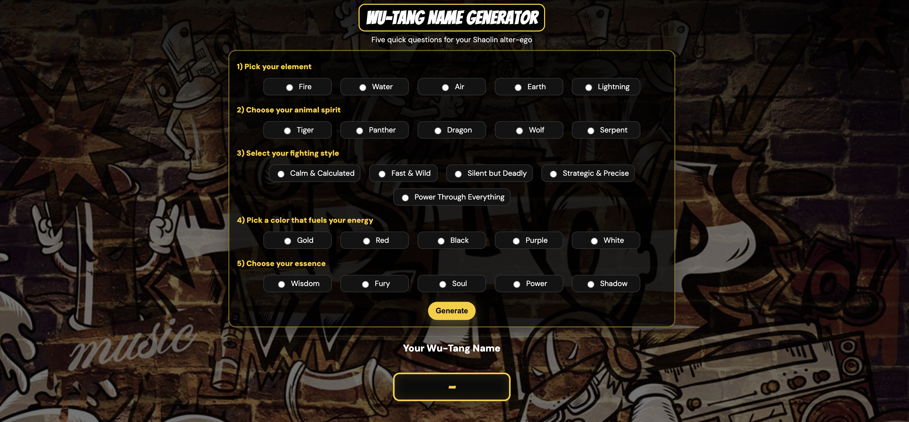

# Wu-Tang Name Generator

A gritty, graffiti-styled quiz app that creates a unique Wu-Tang Clan-inspired alias.  
Answer five quick questions and reveal your Shaolin alter-ego.

[Link to project](https://wu-tang-generator.vercel.app/)  

---

## How It’s Made:
**Tech used:** HTML, CSS, JavaScript  

Five quick-choice questions shape your Wu-Tang identity.
Each selected option contributes to a total value, which is then used to pull a name from the list.
This keeps results consistent every time you choose the same answers.
The design features a bold graffiti backdrop, a gold-trimmed title badge, and centered option pills that bring a clean balance to the layout.

---

## Optimizations
- Adjusted layout so all content fits on screen without scrolling  
- Centered options while keeping legends left-aligned for readability  
- Balanced graffiti background using `background-position: 60% center`  
- Added subtle overlays for text clarity against bright wall textures  
- Simplified JavaScript logic for deterministic results with minimal code  

---

## Lessons Learned
- Building a deterministic generator using index math instead of random values  
- Keeping radio input groups accessible and visually balanced  
- Refining color contrast and overlay blending on busy images  
- Maintaining consistent styling while minimizing code complexity  

---

## Next Steps
- Add optional soundtrack integration (Spotify “C.R.E.A.M.” on click)  
- Expand name library with rarer Wu-Tang-style titles  
- Include animated graffiti tags or subtle smoke effects  
- Introduce light/dark graffiti wall variations for theme toggling  
