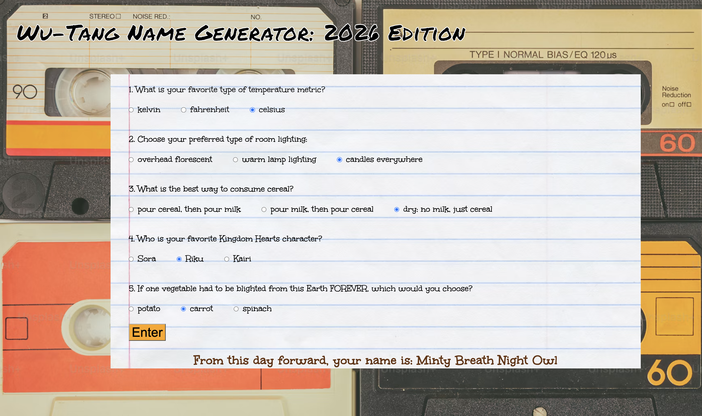

# 🐝 Wu-Tang Name Generator

A generator that turns your name into a Wu-Tang Clan–style alias. Built with HTML, CSS, and server-side JavaScript. 

### Project Description

A generator that turns your name into a Wu-Tang Clan–style nickname/alias. It presents the user with 5 survey questions and based on those answers, randomly generates a name. No EXPRESS! It's my take on the original generator (built on php and may be unsafe to visit at the moment). The styling is old-school hip-hop-themed to match the subject.

### Live Link
To access this web app, click on the link in the About section of this repo or simply [**click here**](https://wu-tang-generator-6ibp.onrender.com/)



### Features:

- **Multiple Choice Answering** — answer 5 multiple choice quesions and submit it to generate an alias.
- **Generated alias** — displays the resulting Wu-Tang name on the page.
- **Random selection** — the alias is assembled from an array of strings rather than hardcoded question, so results vary.
- **Web Application** — use of `npm install` to install dependencies. 
- **Custom styling** — a hand-written stylesheet in `css/styles.css` and a Google Fonts stack.

### Tech Used:

- **Frontend:** HTML, CSS, JavaScript (vanilla, no framework)
- **Backend:** JavaScript
- **Browser APIs:** `document.querySelector`, `addEventListener`
- **Data:** word lists stored in arrays in `server.js`
- **Hosting:** GitHub Pages

### Things I Learned:

- Accessibility:
  - Using `<label>`, and `<input>` so the generator works with a keyboard and a screen reader, not just a mouse.
  - Allowing users to click on any part of the multiple choice text or radio button, expaning the click area for people with mobility issues. 
- JavaScript fundamentals:
  - Storing names in arrays and pick from them with `Math.random()` and `Math.floor()`.
  - How to write the result into the page with `innerText`.
  - This was a great way to practice calling arrays from server.js to main.js. 
  - I also learned more about game logic by using `forEach()` to loop through the possible survey answers (a, b, or c) and to count which answer was most picked to determine what message the user will get back. 
- Deployment:
  - GitHub Pages onyl works for static sites so I learned to use Render to deploy this web app.

### How to Use:

1. Visit this website using the live link by [**clicking here**](https://wu-tang-generator-6ibp.onrender.com/)

2. Answer the multiple choice questions and wait for your very own Wu Tang name!

3. Or make this project your own by taking the following steps:

- Step 1. Clone this repository:
```bash
git clone https://github.com/priscilla-ruilova/wu-tang-generator.git
```
- Step 2. Navigate to the project:
```bash
cd wu-tang-generator
```
- Step 3. Run this command in the terminal to install dependencies `npm install` 

- Step 4. Run this command to start your app `npm run start`  

- Step 5. Edit the styling and list names however you want!

## Happy Coding!