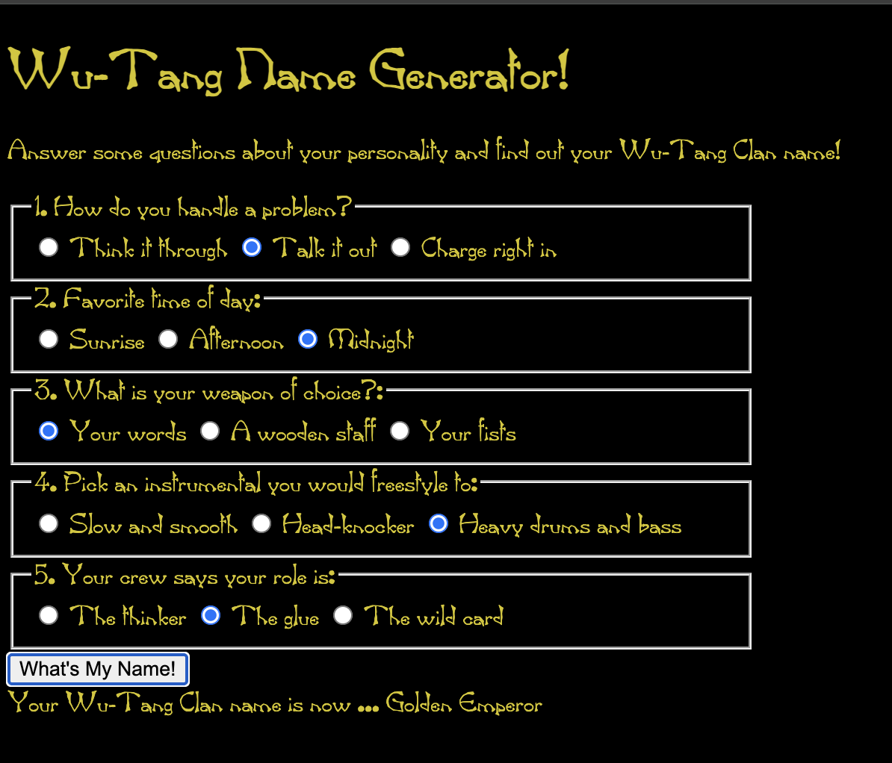

# Wu-Tang Name Generator

Answer five personality questions and get your Wu-Tang Clan name — from Quiet Monk to Unstoppable Warrior.

Live demo: https://wu-tang-generator-cagz.onrender.com/



## What it does

- Five questions, three answers each, worth 1 to 3 points — how you handle a problem, favorite time of day, weapon of choice, freestyle instrumental, and your role in the crew.
- Click "What's My Name!" and the server adds up your score (5–15) and returns the matching name from its name bank (`GET /name?q1=…&q2=…&q3=…&q4=…&q5=…`).
- Names run from the calm end (Quiet Monk, Hidden Oracle) to the fierce end (Thunderous Tiger, Unstoppable Warrior).

## Tech stack

- Node.js — plain `http` and `fs` modules, no framework
- HTML, CSS, vanilla JavaScript
- figlet (for the 404 page)

## How to run it

```bash
npm install
node server.js
```

Open http://localhost:8000. There is no `npm start` script in this repo — run `node server.js` directly.

## Project structure

```
server.js            - Node http server (port 8000), name bank, /name endpoint
index.html           - the five questions and the result
js/main.js           - sends your answers to /name and shows your Wu-Tang name
css/style.css        - page styling
fonts/Bamboo-Regular.ttf - display font
package.json         - dependencies (figlet)
```

---

Thay Brown — thaybrown22@gmail.com · https://thaythecoder.netlify.app · https://github.com/tbrown320 · https://www.linkedin.com/in/thaybrown
